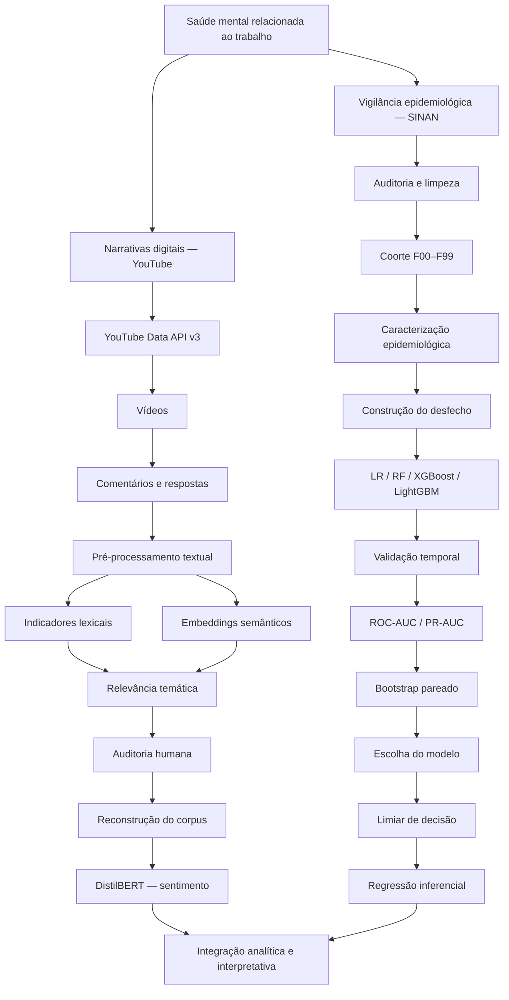
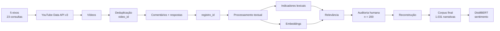
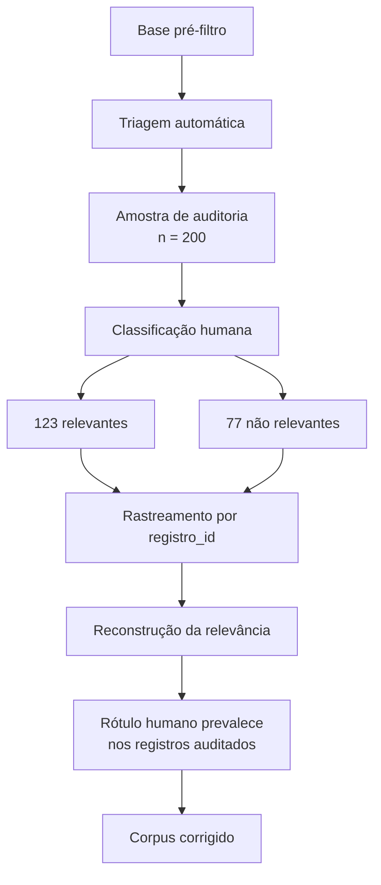
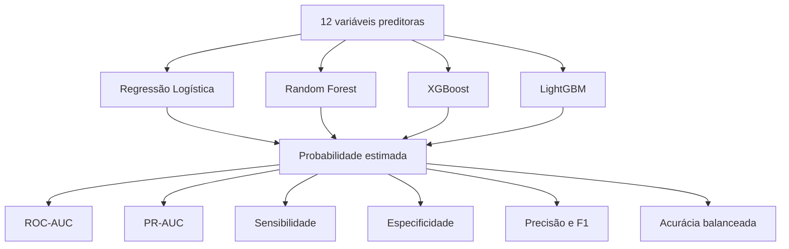
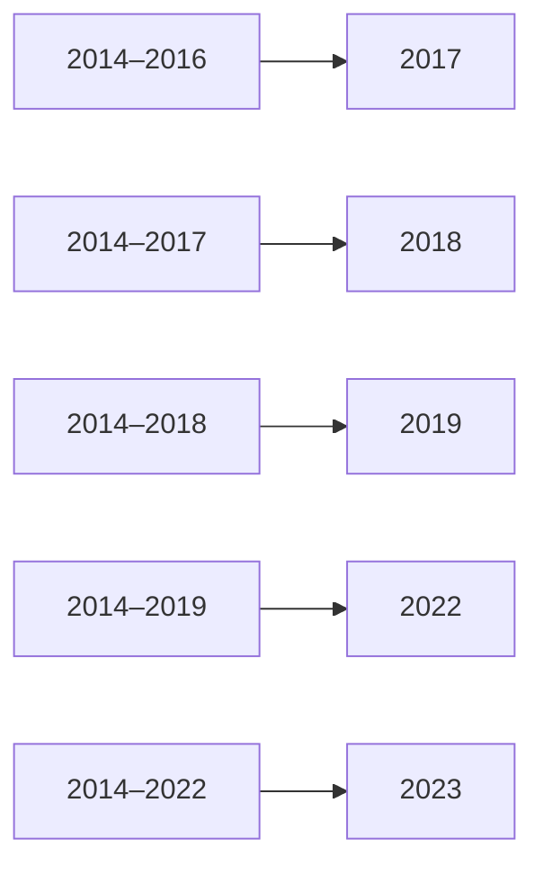
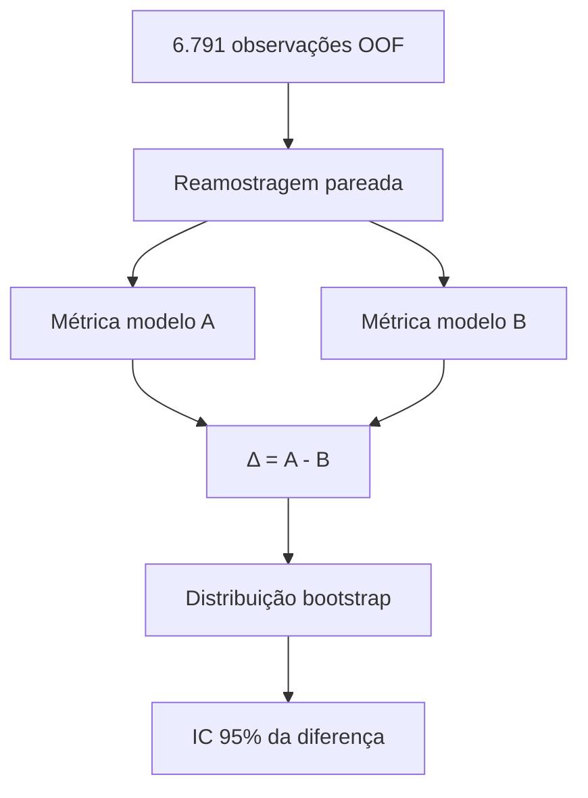
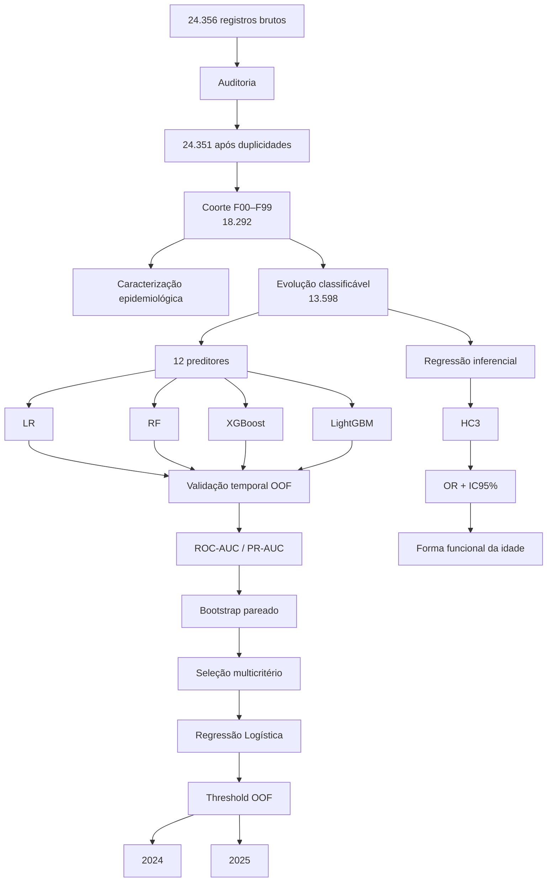
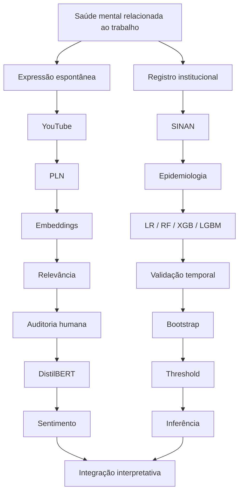

# Riscos Psicossociais e Saúde Mental do Trabalhador no Contexto da NR-1

### Integração entre Narrativas Digitais, Dados do SINAN e Aprendizado de Máquina

---

**Trabalho de Conclusão de Curso — MBA em Data Science & Analytics**  
**Universidade de São Paulo — USP**  
**Escola Superior de Agricultura “Luiz de Queiroz” — ESALQ**  
**PECEGE — Programa de Educação Continuada em Economia e Gestão**

**Autora:** Kymie Karina Silva Saito  
**Orientadora:** Profa. Gabrielle  
**Área:** Data Science & Analytics  
**Ano:** 2026  

---

> **Repositório computacional do Trabalho de Conclusão de Curso**
>
> Este repositório reúne a documentação metodológica, os códigos e os resultados
> computacionais desenvolvidos para investigar riscos psicossociais e saúde mental
> relacionada ao trabalho a partir de duas perspectivas complementares:
> **narrativas digitais públicas** e **registros do Sistema de Informação de Agravos
> de Notificação (SINAN)**.
>
> O estudo combina **Social Listening**, **Processamento de Linguagem Natural (PLN)**,
> representações semânticas por *embeddings*, validação humana, modelos Transformer,
> análise de sentimento, aprendizado de máquina supervisionado, validação temporal,
> análise de limiar de decisão e modelagem estatística inferencial.

**Palavras-chave:** saúde mental ocupacional · riscos psicossociais · NR-1 · SINAN ·
Social Listening · Processamento de Linguagem Natural · Machine Learning ·
Regressão Logística

---

### Visão geral do projeto

`Social Listening` · `NLP` · `Embeddings` · `Sentence Transformers` ·
`Human-in-the-loop` · `DistilBERT` · `SINAN` · `Logistic Regression` ·
`Random Forest` · `XGBoost` · `LightGBM` · `Temporal Validation` ·
`Bootstrap` · `Statistical Inference`

---

# Do relato espontâneo à vigilância epidemiológica

O trabalho não constitui apenas uma fonte de renda. Ele participa da construção de
identidade, pertencimento, relações sociais, propósito e organização da vida cotidiana.
Em condições adequadas, pode exercer papel protetivo para a saúde mental; em condições
desfavoráveis, determinadas características da organização e das relações de trabalho podem
constituir fontes relevantes de risco psicossocial.

A literatura científica sustenta essa relação. Harvey et al. (2017), em uma meta-revisão
sistemática sobre fatores ocupacionais e problemas comuns de saúde mental, identificaram
dimensões relacionadas ao desenho do trabalho, à insegurança ocupacional e à ausência de
valor e respeito no ambiente laboral.

Entre os fatores para os quais foram encontradas evidências prospectivas destacaram-se
altas demandas, baixo controle sobre o trabalho, desequilíbrio entre esforço e recompensa,
baixa justiça relacional e procedimental, estresse relacionado ao papel desempenhado,
*bullying* e baixo suporte social.

A Organização Mundial da Saúde (OMS) estima que depressão e ansiedade estejam associadas,
globalmente, à perda de aproximadamente 12 bilhões de dias de trabalho por ano e a cerca de
US$ 1 trilhão anual em produtividade perdida.

Esses valores não devem ser interpretados simplesmente como a contagem direta de 12 bilhões
de faltas registradas. Tratam-se de estimativas agregadas de perda de produtividade. De forma
didática e simplificada, a ordem de grandeza de uma estimativa populacional desse tipo pode
ser representada por:

$$
D_{\text{perdidos}}
\approx
N_{\text{afetados}}
\times
\bar{D}_{\text{perda produtiva}}
$$

em que
$N_{\text{afetados}}$ 
representa a população estimada de pessoas afetadas;
$\bar{D}_{\text{perda produtiva}}$ 
representa a perda média de produtividade convertida em
dias equivalentes.

Conceitualmente, perdas de produtividade associadas à saúde mental podem envolver
componentes como absenteísmo e presenteísmo, além de efeitos relacionados à participação e
à permanência no trabalho.

O **absenteísmo** corresponde à ausência ao trabalho. O **presenteísmo**, por sua vez,
representa situações nas quais o indivíduo permanece trabalhando, mas apresenta redução de
sua capacidade produtiva.

Essa representação matemática possui finalidade didática e não pretende reproduzir
integralmente o modelo econômico utilizado na estimativa internacional.

No Brasil, a discussão adquiriu relevância regulatória adicional com a inclusão expressa dos
fatores de riscos psicossociais relacionados ao trabalho no Gerenciamento de Riscos
Ocupacionais (GRO) da Norma Regulamentadora nº 1 (NR-1).

Essas evidências conduzem a uma questão central para este projeto de Ciência de Dados:

> **Onde esse fenômeno pode ser observado nos dados?**

Uma possibilidade são os sistemas formais de vigilância. O Sistema de Informação de Agravos
de Notificação (SINAN) permite observar transtornos mentais relacionados ao trabalho que
alcançaram os serviços e o sistema de vigilância em saúde.

Mas essa é apenas uma perspectiva.

Experiências de pressão, sobrecarga, assédio, medo, conflitos, ausência de reconhecimento,
esgotamento e sofrimento relacionado ao trabalho também podem ser expressas espontaneamente
fora dos sistemas institucionais.

Parte dessas manifestações ocorre em ambientes digitais.

Este projeto parte justamente da diferença entre **o que é narrado** e **o que é formalmente
registrado**.

---

# Arquitetura analítica do estudo

O estudo foi organizado em dois pipelines computacionalmente independentes.

Os dois pipelines respondem a perguntas diferentes.

No componente digital:

$$\text{texto}
\rightarrow
\text{representação}
\rightarrow
\text{relevância}
\rightarrow
\text{auditoria humana}
\rightarrow
\text{sentimento}$$

No SINAN:
$$\text{registro}
\rightarrow
\text{coorte}
\rightarrow
\text{desfecho}
\rightarrow
\text{predição}
\rightarrow
\text{validação temporal}
\rightarrow
\text{inferência}$$

Não foi realizado `merge` entre YouTube e SINAN.

As duas fontes não representam a mesma população e não existe correspondência individual
entre um usuário que publicou uma narrativa no YouTube e uma pessoa notificada no SINAN.

A integração ocorre no nível analítico e interpretativo:

> **As narrativas digitais permitem observar como o fenômeno é expresso; o SINAN permite
> observar como ele é registrado; o aprendizado de máquina investiga até que ponto seus
> desfechos podem ser discriminados; e a análise inferencial investiga quais características
> permanecem associadas a esses desfechos após ajuste.**

---

# Pipeline 1 — Narrativas digitais e Processamento de Linguagem Natural

## 1. Recuperação das narrativas digitais

A primeira etapa apresentou um problema típico de Processamento de Linguagem Natural:
transformar manifestações textuais não estruturadas em um corpus passível de análise
computacional sem eliminar o contexto semântico que torna essas narrativas informativas.

A recuperação foi realizada por meio da **YouTube Data API v3**.

A estratégia de busca foi estruturada em **cinco eixos temáticos** e **23 consultas**,
abrangendo:

1. NR-1, GRO e PGR;
2. saúde mental relacionada ao trabalho;
3. riscos psicossociais;
4. cultura e gestão organizacional;
5. transformações contemporâneas do trabalho.

O pipeline geral pode ser representado como:

Os vídeos recuperados em diferentes consultas foram consolidados pelo identificador
`video_id`, evitando que o mesmo vídeo fosse contabilizado repetidamente apenas por ter sido
recuperado por diferentes termos de busca.

Comentários principais e respostas foram associados aos respectivos vídeos.

Cada narrativa recebeu um identificador único, `registro_id`, utilizado para manter sua
rastreabilidade ao longo das diferentes etapas:
$$ \text{registro original}
\rightarrow
\text{processamento}
\rightarrow
\text{relevância}
\rightarrow
\text{auditoria}
\rightarrow
\text{corpus final} $$

Essa decisão mostrou-se particularmente importante quando a auditoria humana indicou a
necessidade de retornar a uma etapa anterior do pipeline e reconstruir a seleção temática.

---

# 2. Recuperação lexical não é compreensão semântica

A utilização de palavras-chave é adequada para recuperação inicial de informação, mas não é
suficiente para representar integralmente o significado de uma narrativa.

Considere:

> "Estou sofrendo com riscos psicossociais no trabalho."

e:

> "Aqui ninguém fala nada porque todo mundo tem medo do chefe."

A primeira narrativa contém explicitamente o vocabulário técnico utilizado na pesquisa.

A segunda não precisa conter as expressões "risco psicossocial", "NR-1" ou "saúde mental",
mas pode apresentar conteúdo diretamente relacionado a medo, relações hierárquicas,
segurança psicológica e cultura organizacional.

Em uma representação estritamente lexical, os dois textos podem parecer distantes.

Em uma representação semântica, entretanto, eles podem ocupar regiões próximas do espaço de
significado.

Essa diferença motivou uma estratégia híbrida:

$$ \text{informação lexical}+\text{informação semântica}$$

---

# 3. Cultura organizacional e o referencial de Schein

A interpretação das narrativas relacionadas ao ambiente organizacional foi informada pela
perspectiva de cultura organizacional de Edgar H. Schein.

Schein e Schein distinguem diferentes níveis de profundidade da cultura organizacional:
**artefatos**, **crenças e valores declarados** e **pressupostos básicos subjacentes**.

Os artefatos correspondem às manifestações mais diretamente observáveis da organização,
como práticas, comportamentos, linguagem, processos e estruturas.

As crenças e os valores declarados correspondem ao que a organização ou seus integrantes
afirmam valorizar.

Os pressupostos básicos subjacentes são mais profundos, frequentemente implícitos e
naturalizados, influenciando a maneira como situações são percebidas e interpretadas.

Essa perspectiva é relevante para a análise de narrativas espontâneas porque uma pessoa não
precisa utilizar terminologia acadêmica ou normativa para descrever uma experiência
organizacional.

Uma narrativa como:

> "Quem sai no horário é visto como alguém que não veste a camisa."

pode revelar elementos relacionados a normas implícitas, pressão social e cultura
organizacional sem utilizar qualquer dessas expressões.

Schein fornece, portanto, uma **lente conceitual para a interpretação do fenômeno**.

A transformação dessa linguagem em uma representação matemática, entretanto, pertence ao
campo do PLN.

---

# 4. Embeddings: transformando linguagem em geometria

Para que textos possam ser comparados computacionalmente, é necessário representá-los
numericamente.

Considere uma narrativa:

$$x_i=(w_1,w_2,\ldots,w_T)$$

formada por uma sequência de tokens.

Um modelo de *embedding* pode ser representado como uma função:
$$f:x_i\rightarrow\mathbf{v}_i\in\mathbb{R}^{d}$$

produzindo:

$$\mathbf{v}_i=f(x_i)$$

em que:

$$\mathbf{v}_i=(v_{i1},v_{i2},\ldots,v_{id})$$

é a representação vetorial da narrativa em um espaço semântico de dimensão $d$.

No pipeline foi utilizada uma representação semântica multilíngue baseada em
**Sentence Transformers**, com o modelo
`paraphrase-multilingual-mpnet-base-v2`.

O objetivo não foi associar cada dimensão do vetor a uma variável diretamente observável.
Em modelos de representação distribuída, o significado emerge da configuração conjunta das
dimensões latentes.

A consequência é particularmente útil neste projeto:

> **duas narrativas não precisam compartilhar exatamente as mesmas palavras para apresentar
> representações semanticamente próximas.**

---

# 5. Similaridade do cosseno

Uma vez representadas em um espaço vetorial comum, narrativas podem ser comparadas por
medidas geométricas de proximidade.

Para dois vetores

$$\mathbf{u}$$
e 
$$\mathbf{v}$$, 

Para dois vetores 
$$\mathbf{u}$$
e $$\mathbf{v}$$, 

a similaridade do cosseno é definida por:

$$\mathrm{sim}_{\cos}(\mathbf{u},\mathbf{v})=\frac{\mathbf{u}^{T}\mathbf{v}}{\lVert\mathbf{u}\rVert_2 \lVert\mathbf{v}\rVert_2}$$

ou, de forma expandida:

$$\mathrm{sim}_{\cos}(\mathbf{u},\mathbf{v})=\frac{\sum_{j=1}^{d}u_jv_j}{\sqrt{\sum_{j=1}^{d}u_j^2}\sqrt{\sum_{j=1}^{d}v_j^2}}$$

Essa medida compara predominantemente a orientação dos vetores no espaço de representação.
A pergunta computacional deixa, portanto, de ser apenas:

> "Os textos possuem as mesmas palavras?"

e passa a incluir:

> **"Os textos apresentam proximidade de significado no espaço semântico?"**

Essa propriedade é especialmente importante em linguagem espontânea, caracterizada por
sinônimos, abreviações, expressões coloquiais, descrições indiretas e diferentes formas de
relatar experiências semelhantes.

---

# 6. Estratégia de busca e engenharia de atributos

As consultas utilizadas na API e as características posteriormente construídas possuem funções distintas.

As consultas representam uma estratégia de **recuperação de informação**. Seja \(Q\) o conjunto de consultas definidas para o estudo:

$$Q = \{q_1,q_2,\ldots,q_m\}.$$

A aplicação dessas consultas à API produz um conjunto inicial de registros textuais:

$$Q \longrightarrow \mathcal{D}_{raw}.$$

A engenharia de atributos ocorre posteriormente. Para cada registro textual \(r_i \in \mathcal{D}_{raw}\), constrói-se um vetor de características:

$$r_i \longrightarrow \mathbf{x}_i$$.

Esse vetor reúne diferentes grupos de atributos:

$$\mathbf{x}_i =[\mathbf{x}_i^{(est)},\mathbf{x}_i^{(lex)},\mathbf{x}_i^{(ctx)},\mathbf{x}_i^{(sem)}]$$
.

Foram considerados atributos estruturais e textuais, idioma, extensão da narrativa, relação entre comentário e resposta, indicadores lexicais associados ao domínio e representações semânticas.

# 7. Relevância temática como etapa própria

Um comentário publicado em um vídeo sobre NR-1 ou saúde mental não é necessariamente uma
narrativa relevante sobre riscos psicossociais ou saúde mental relacionada ao trabalho.

Por isso, foi necessário definir uma variável de relevância:

$$ R_i=\begin{cases}1, & \text{se a narrativa for tematicamente relevante}\\0, & \text{caso contrário}\end{cases}$$

Por exemplo:

> "Excelente conteúdo!"

pode apresentar sentimento positivo, mas não fornecer informação substantiva sobre o objeto
científico investigado.

Da mesma maneira, agradecimentos, elogios genéricos, manifestações políticas isoladas ou
comentários sem relação substantiva com saúde mental e trabalho poderiam contaminar o corpus
caso o contexto do vídeo fosse utilizado como único critério.

Isso levou à separação de dois problemas:

### Problema 1 — Relevância
$$ P(R_i=1\mid x_i)$$
### Problema 2 — Sentimento, condicionado à relevância
$$P(S_i=k\mid x_i,R_i=1)$$
em que:
$$k\in\{\text{negativo},\text{neutro},\text{positivo}\}$$

Assim:
$$\boxed{\text{relevância}\neq\text{sentimento}}$$
---

# 8. Human-in-the-loop: auditoria humana da relevância

A classificação automática foi submetida a auditoria humana.

Foram avaliadas **200 narrativas**.

| Classificação humana | n | % |
|---|---:|---:|
| Relevante | 123 | 61,5% |
| Não relevante | 77 | 38,5% |
| **Total** | **200** | **100,0%** |

A auditoria mostrou que a decisão automática não deveria ser utilizada como verdade
observacional definitiva.

Mais importante, identificou-se que registros relevantes e não relevantes também estavam
distribuídos fora do conjunto que havia sobrevivido a etapas anteriores de filtragem.

Isso motivou uma reconstrução da seleção a partir de uma base anterior ao filtro final.

Nos registros auditados, a decisão humana recebeu prioridade sobre a classificação
automática.

A auditoria, portanto, não funcionou apenas como uma etapa de mensuração de desempenho.

Ela alterou a própria construção do conjunto analítico.

Em termos de Ciência de Dados:
$$\text{modelo}\rightarrow\text{auditoria humana}\rightarrow\text{diagnóstico}\rightarrow\text{reconstrução do dado}$$
Essa arquitetura caracteriza um processo **human-in-the-loop**.

---

# 9. Corpus temático final

Após a reconstrução:
$$N_{\text{narrativas}}=1.031$$

narrativas tematicamente relevantes foram mantidas para o recorte de 2026.

Essas narrativas estavam distribuídas em:
$$N_{\text{vídeos}}=196$$

vídeos.

Esses valores representam o **corpus analítico recuperado pelo procedimento do estudo**.

Não representam prevalência populacional de riscos psicossociais entre trabalhadores.

---

# 10. Transformer e análise de sentimento

Somente depois da definição da relevância temática foi realizada a análise de sentimento.

A ordem metodológica foi:
$$\boxed{\text{narrativa}
\rightarrow
\text{relevância}
\rightarrow
\text{sentimento}
}$$
Para essa etapa foi utilizado o modelo multilíngue pré-treinado:

`lxyuan/distilbert-base-multilingual-cased-sentiments-student`

baseado na arquitetura **DistilBERT**.

O BERT pertence à família Transformer e utiliza mecanismos de atenção para construir
representações contextualizadas dos tokens.

De forma simplificada, o mecanismo de *scaled dot-product attention* pode ser representado
por:
$$ \operatorname{Attention}(Q,K,V)=\operatorname{softmax}\left(\frac{QK^{T}}{\sqrt{d_k}}\right)V$$
em que:
- $Q$
- representa as *queries*;
- $K$
-  representa as *keys*;
- $V$
-  representa os *values*;
- $d_k$
-  representa a dimensão utilizada na normalização.

Essa arquitetura permite que a representação de uma palavra dependa do contexto formado
pelos demais elementos da sequência.

O DistilBERT corresponde a uma versão compacta da arquitetura BERT obtida por
**knowledge distillation**, buscando preservar parte substancial da capacidade do modelo
original com menor custo computacional.

Neste projeto, o modelo foi utilizado como modelo **pré-treinado de inferência**.

Não foi realizado *fine-tuning* no corpus do TCC.

---

# 11. Probabilidades de sentimento

Para cada narrativa relevante $x_i$, o modelo produziu probabilidades para três classes:

$$\mathbf{p}_i= \begin{bmatrix} P(S_i=\text{negativo}\mid x_i)\\ P(S_i=\text{neutro}\mid x_i)\\ P(S_i=\text{positivo}\mid x_i)\end{bmatrix}$$

sujeitas a:

$$\sum_{k=1}^{3}P(S_i=k\mid x_i)=1 $$

A classificação automática corresponde à classe com maior probabilidade:

$$\hat S_i=\arg\max_{k}P(S_i=k\mid x_i)$$

Além da classe final, foram preservados no pipeline:

- sentimento previsto;
- confiança da classificação;
- probabilidade positiva;
- probabilidade neutra;
- probabilidade negativa.

O processamento foi realizado em lotes de **32 registros**, com truncamento máximo em
**512 tokens** e utilização de GPU quando disponível.

---

# 12. Avaliação crítica da classificação de sentimento

A utilização de um Transformer não elimina incertezas de classificação.

Sentimento pode ser influenciado por contexto, ironia, ambiguidade, negação, intensidade
emocional e especificidades do domínio.

Durante o desenvolvimento, uma amostra de 200 registros foi utilizada para comparação entre
a classificação automática e uma classificação assistida. Entretanto, essa referência não
correspondeu integralmente a uma rotulação humana independente.

Por essa razão, seus indicadores não foram tratados como estimativas definitivas da acurácia
do DistilBERT no corpus.

Uma estratégia de calibração também foi investigada, mas não apresentou robustez suficiente
para justificar sua aplicação ao conjunto completo.

Consequentemente, não foi realizado *fine-tuning* nem aplicada calibração final ao corpus
completo.

Essa decisão evita apresentar uma etapa exploratória de desenvolvimento como se fosse uma
validação externa definitiva do modelo.

---

# 13. Distribuição final de sentimento

Das 1.031 narrativas relevantes:
$$ N_{\text{sentimento}}=974$$
possuíam classificação de sentimento disponível.

As demais:
$$N_{\text{sem sentimento}}=57$$
foram preservadas no corpus e excluídas somente das análises cuja variável de interesse era
sentimento.

Portanto:
$$N_{\text{corpus}}=1.031 \neq N_{\text{sentimento}}=974$$
Entre as 974 narrativas classificadas:

| Sentimento | n | % |
|---|---:|---:|
| Negativo | 460 | 47,23% |
| Neutro | 377 | 38,71% |
| Positivo | 137 | 14,07% |
| **Total** | **974** | **100,00%** |

Matematicamente:
$$P(S=\text{negativo}\mid R=1,S\text{ disponível})=\frac{460}{974}=0,4723$$
$$P(S=\text{neutro}\mid R=1,S\text{ disponível})=\frac{377}{974}=0,3871$$
$$P(S=\text{positivo}\mid R=1,S\text{ disponível})=\frac{137}{974}=0,1407$$

O condicionamento é fundamental.

Esses percentuais descrevem **o corpus recuperado e considerado relevante**, não a população
trabalhadora brasileira.

---

# 14. O que o pipeline digital pode responder?

O pipeline permite investigar:

- como experiências relacionadas ao trabalho são expressas em narrativas digitais;
- quais narrativas apresentam pertinência temática ao domínio;
- relações de proximidade semântica entre textos;
- distribuição de sentimento no corpus relevante;
- padrões linguísticos e temáticos presentes no material recuperado.

Entretanto:

$$P(\text{característica}\mid\text{corpus YouTube})\neq P(\text{característica}\mid\text{trabalhadores brasileiros})$$

Usuários do YouTube não constituem amostra probabilística da população trabalhadora.

A publicação de comentários está sujeita à autoseleção, ao interesse pelo conteúdo, à
recomendação algorítmica da plataforma e a diferentes formas de engajamento.

Além disso:

> **narrativa negativa não é diagnóstico clínico.**

O objetivo do Social Listening neste projeto é caracterizar manifestações discursivas
presentes no corpus, e não estimar prevalência epidemiológica.

---

# Pipeline 2 — SINAN, aprendizado de máquina e análise inferencial

## 15. Construção da base epidemiológica

O segundo pipeline parte de registros estruturados de vigilância epidemiológica.

A base inicial continha:
$$N_{\text{bruto}}=24.356$$

registros.

Foram identificadas cinco duplicidades exatas:
$$N_{\text{limpo}}=24.356-5=24.351$$

Após a padronização dos códigos da CID-10 e definição da coorte pertencente ao capítulo
F00–F99:
$$N_{\text{epidemiológico}}=18.292$$
registros foram mantidos para a caracterização epidemiológica.

A série disponível compreendeu registros de 2014 a 2019 e de 2022 a 2025.

A ausência de observações disponíveis para 2020 e 2021 foi preservada como **lacuna na
série**, e não convertida artificialmente em contagem zero.

---
# 16. Definição do problema supervisionado

A modelagem supervisionada respondeu a uma pergunta específica:

> **Entre os registros de transtornos mentais relacionados ao trabalho já notificados no SINAN e com evolução classificável, as características disponíveis permitem discriminar os casos com incapacidade ou óbito daqueles classificados como cura ou cura não confirmada?**

Para cada registro \(i\), definiu-se uma variável-alvo binária \(Y_i\), em que:

- \(Y_i = 1\): **desfecho com incapacidade ou óbito**, compreendendo incapacidade temporária, incapacidade permanente parcial, incapacidade permanente total ou óbito relacionado ao trabalho;
- \(Y_i = 0\): **desfecho sem incapacidade ou óbito**, compreendendo cura ou cura não confirmada.

Essa operacionalização **não representa uma escala de gravidade clínica**. Trata-se de uma classificação analítica construída a partir da evolução registrada no SINAN para possibilitar a formulação do problema de classificação supervisionada.

Após a aplicação dos critérios de elegibilidade do desfecho, a base utilizada na modelagem compreendeu:

$$
N = 13598
$$

registros, distribuídos entre:

$$
N_1 = 11027
$$

registros da classe positiva e

$$
N_0 = 2571
$$

registros da classe negativa.

A proporção amostral da classe positiva foi calculada por:

$$ \hat{\pi} = \frac{N_1}{N} = \frac{11027}{13598} = 0.8109 $$

correspondendo a aproximadamente **81,09%** dos registros utilizados na modelagem.

Consequentemente, a classe negativa correspondeu a aproximadamente **18,91%** da amostra. Essa distribuição evidencia um desbalanceamento entre as classes, aspecto considerado posteriormente na escolha das métricas de avaliação dos classificadores.

---
# 17. Variáveis preditoras

A modelagem principal utilizou **12 variáveis preditoras**, selecionadas entre as informações disponíveis nos registros do SINAN.

A idade foi utilizada como variável numérica. As demais características foram tratadas como variáveis categóricas e compreenderam: sexo, raça/cor, escolaridade, unidade federativa, situação de trabalho, terceirização, grande grupo da Classificação Brasileira de Ocupações (CBO), agrupamento diagnóstico da CID-10, consumo de álcool, uso de drogas e tabagismo.

A seleção dos atributos considerou não apenas sua disponibilidade, mas também sua relação temporal e conceitual com o desfecho. Variáveis potencialmente determinadas durante ou após a evolução do caso, ou que pudessem incorporar informação excessivamente próxima da definição do próprio desfecho, não foram utilizadas na modelagem principal, com o objetivo de reduzir o risco de **vazamento de informação (*data leakage*)**.

Além disso, o tratamento dos atributos foi incorporado ao fluxo de modelagem de modo a preservar a separação entre treinamento e avaliação. As transformações necessárias foram ajustadas exclusivamente com os dados de treinamento e posteriormente aplicadas aos respectivos conjuntos de avaliação, evitando que informações provenientes de períodos posteriores fossem utilizadas durante o ajuste dos modelos.

---
# 18. Formulação matemática do problema supervisionado

A etapa preditiva foi formalizada a partir de um conjunto de dados com \(n\) registros:

$$
\mathcal{D} = \{(\mathbf{x}_i,y_i)\}_{i=1}^{n}
$$

Para cada registro \(i\), o vetor de características foi representado por:

$$
\mathbf{x}_i = (x_{i1},x_{i2},\ldots,x_{ip})
$$

em que \(p\) corresponde ao número de variáveis preditoras.

O desfecho observado foi representado por:

$$
y_i \in \{0,1\}
$$

sendo \(y_i=1\) correspondente ao desfecho com incapacidade ou óbito e \(y_i=0\) ao desfecho sem incapacidade ou óbito.

O problema de classificação consistiu em estimar uma função:

$$
f:\mathcal{X}\rightarrow[0,1]
$$

que, a partir do vetor de características de cada registro, produzisse uma probabilidade estimada:

$$
\hat{p}_i = f(\mathbf{x}_i)
$$

Essa saída foi interpretada como uma estimativa da probabilidade condicional da classe positiva:

$$
\hat{p}_i \approx P(Y_i=1\mid\mathbf{x}_i)
$$

Assim, os algoritmos comparados buscaram estimar a mesma quantidade de interesse, utilizando estruturas matemáticas distintas para representar a relação entre as características observadas e o desfecho.

Foram comparados quatro modelos:

1. **Regressão Logística (LR)**;
2. **Random Forest (RF)**;
3. **XGBoost (XGB)**;
4. **LightGBM (LGBM)**.

A comparação foi realizada sob o mesmo desenho de validação temporal, permitindo avaliar empiricamente o comportamento preditivo dos quatro modelos.

---

# 19. Regressão Logística
Na Regressão Logística, modela-se a probabilidade condicional:

$$
p_i=P(Y_i=1\mid\mathbf{x}_i).
$$

Como uma combinação linear das variáveis pode assumir qualquer valor real, utiliza-se a transformação *logit*:

$$
\mathrm{logit}(p_i)=\log(\frac{p_i}{1-p_i}).
$$

O modelo é definido por:

$$
\mathrm{logit}(p_i)=\beta_0+\sum_{j=1}^{p}\beta_jx_{ij}.
$$

Definindo o preditor linear:

$$
\eta_i=\beta_0+\sum_{j=1}^{p}\beta_jx_{ij},
$$

a probabilidade é obtida pela função logística:

$$
p_i=\sigma(\eta_i)=\frac{1}{1+\exp(-\eta_i)},
$$

de modo que:

$$
0<p_i<1.
$$

Para uma resposta binária:

$$
Y_i\sim\mathrm{Bernoulli}(p_i).
$$

A função de verossimilhança pode ser escrita como:

$$
L(\boldsymbol{\beta})=\prod_{i=1}^{n} p_i^{y_i}(1-p_i)^{1-y_i}.
$$

Equivalentemente, a log-verossimilhança é:

$$
\ell(\boldsymbol{\beta}) =\sum_{i=1}^{n}[y_i\log(p_i)+(1-y_i)\log(1-p_i)].
$$

A estimação busca os coeficientes:

$$
\hat{\boldsymbol{\beta}} = (\hat\beta_0,\hat\beta_1,\ldots,\hat\beta_p)
$$

que maximizam a compatibilidade entre os desfechos observados e as probabilidades produzidas pelo modelo.

A mesma expressão também pode ser relacionada à *binary cross-entropy* ou *log-loss*:

$$
\mathcal{L}_{\text{log}}=-\frac{1}{n}\sum_{i=1}^{n}[y_i\log(\hat p_i)+(1-y_i)\log(1-\hat p_i)].
$$

Minimizar essa perda equivale, sob essa formulação, a maximizar a log-verossimilhança.

A Regressão Logística apresenta ainda uma característica especialmente importante neste estudo: seus coeficientes podem ser relacionados às *odds*. Para uma variável $X_j$:

$$
OR_j=e^{\beta_j}.
$$

Essa propriedade estabelece uma ponte conceitual entre modelagem probabilística, predição e interpretação estatística.

---
# 20. Árvores de decisão e Random Forest

A Random Forest é construída a partir de múltiplas árvores de decisão. Para compreender a floresta, é útil explicitar primeiro como uma árvore realiza suas divisões.

Considere um nó contendo um conjunto de observações $S$. Para classificação, uma medida comum de heterogeneidade é a impureza de Gini:

$$
G(S) = 1 - \sum_{k=1}^{K} p_k^2
$$

em que $p_k$ representa a proporção de observações da classe $k$ no nó.

No problema binário:

$$
G(S) = 1 - p_0^2 - p_1^2
$$

Uma divisão candidata separa $S$ em dois subconjuntos, $S_L$ e $S_R$. A impureza ponderada após a divisão pode ser escrita como:

$$
G_{\mathrm{split}} = \frac{|S_L|}{|S|}G(S_L) + \frac{|S_R|}{|S|}G(S_R)
$$

A redução de impureza associada à divisão é:

$$
\Delta G = G(S) - G_{\mathrm{split}}
$$

A árvore procura divisões que aumentem a homogeneidade dos nós descendentes, isto é, que produzam maior redução de impureza segundo o critério utilizado.

Uma árvore individual pode ser representada como uma função:

$$
T_b(\mathbf{x})
$$

em que $b$ identifica a árvore e $\mathbf{x}$ representa o vetor de características de uma observação.

A Random Forest introduz diversidade entre as árvores por dois mecanismos principais: amostragem *bootstrap* das observações e seleção aleatória de subconjuntos de variáveis candidatas em cada divisão.

Para cada árvore $b$, uma amostra *bootstrap* é obtida a partir do conjunto original de dados:

$$
\mathcal{D}^{(b)}
\sim
\mathrm{Bootstrap}(\mathcal{D}),
\qquad
b=1,\ldots,B
$$

em que $B$ representa o número total de árvores da floresta.

Para classificação probabilística, cada árvore fornece uma estimativa da probabilidade da classe positiva:

$$
\hat{p}_b(\mathbf{x})=P_b(Y=1\mid\mathbf{x})
$$

A probabilidade final produzida pela Random Forest corresponde à agregação das estimativas das $B$ árvores:

$$
\hat{p}_{\mathrm{RF}}(\mathbf{x})
=\frac{1}{B}\sum_{b=1}^{B}
\hat{p}_b(\mathbf{x})
$$

Assim, diferentes árvores contribuem para a estimativa final, reduzindo a dependência de uma única estrutura de decisão.

A classificação pode então ser obtida mediante um limiar $t$. Para uma observação com vetor de características $\mathbf{x}$, a regra de decisão é:

- $\hat{Y}=1$, se $\hat{p}_{\mathrm{RF}}(\mathbf{x}) \ge t$;
- $\hat{Y}=0$, se $\hat{p}_{\mathrm{RF}}(\mathbf{x}) < t$.

Dessa forma, a Random Forest produz inicialmente uma probabilidade estimada, enquanto a classe predita depende do limiar de decisão adotado.

A combinação de múltiplas árvores permite representar relações não lineares e interações entre variáveis, enquanto a diversificação das árvores e a agregação de suas predições contribuem para reduzir a variância em comparação com uma única árvore de decisão.

**Conceitualmente: Random Forest = árvores diversificadas + agregação.**
---
# 21. Gradient Boosting: XGBoost e LightGBM

XGBoost e LightGBM pertencem à família de métodos de *gradient boosting*.

Diferentemente da Random Forest, na qual as árvores são construídas de forma diversificada e posteriormente agregadas, o boosting constrói modelos de maneira sequencial.

O modelo aditivo após $M$ etapas pode ser representado por:

$$ F_M(\mathbf{x})= F_0(\mathbf{x}) + \sum_{m=1}^{M}\eta h_m(\mathbf{x}),$$

em que:

- $F_0(\mathbf{x})$ representa a estimativa inicial;
- $h_m(\mathbf{x})$ representa a árvore adicionada na etapa $m$;
- $\eta$ representa a taxa de aprendizado;
- $M$ representa o número de etapas de boosting.

A atualização sequencial é:

$$F_m(\mathbf{x}) = F_{m-1}(\mathbf{x}) + \eta h_m(\mathbf{x}).$$

Cada nova árvore é construída com o objetivo de reduzir uma função de perda. De forma geral:

$$\mathcal{L} = \sum_{i=1}^{n} \ell(y_i,\hat y_i).$$

Para classificação binária probabilística, uma função de perda comum é a log-loss:

$$\ell(y_i,p_i)=-[y_i\log(p_i)+(1-y_i)\log(1-p_i)].$$

Assim, o treinamento procura sucessivamente modificar $F(\mathbf{x})$ para reduzir o erro segundo a função objetivo.

## 21.1 XGBoost

O XGBoost estende o princípio de *gradient boosting* incorporando explicitamente regularização à função objetivo.

Na etapa $t$, sua função objetivo pode ser representada de forma geral por:

$$
\mathrm{Obj}^{(t)} = \sum_{i=1}^{n} \ell ( y_i, \hat y_i^{(t-1)}+f_t(\mathbf{x}_i) )+ \Omega(f_t),
$$

em que $f_t$ representa a nova árvore e $\Omega(f_t)$ penaliza a complexidade do modelo.

Uma forma clássica da penalização é:

$$
\Omega(f) = \gamma T + \frac{\lambda}{2} \sum_{j=1}^{T}w_j^2,
$$

em que:

- $T$ representa o número de folhas;
- $w_j$ representa o peso associado à folha $j$;
- $\gamma$ penaliza o aumento do número de folhas;
- $\lambda$ controla a regularização dos pesos.

Para tornar a otimização eficiente, o XGBoost utiliza uma aproximação de segunda ordem da função de perda, envolvendo gradientes e Hessianas:

$$
g_i=\frac{\partial \ell(y_i,\hat y_i)}{\partial \hat y_i},
$$

e:

$$
h_i=\frac{\partial^2 \ell(y_i,\hat y_i)} {\partial \hat y_i^2}.
$$

Dessa forma, a escolha das novas árvores considera a direção de redução do erro e informações sobre a curvatura local da função objetivo.

Conceitualmente:

$$
\boxed{\text{XGBoost} =\text{Gradient Boosting} +\text{regularização} +\text{otimização de segunda ordem}}
$$

## 21.2 LightGBM

O LightGBM também implementa *gradient boosting* baseado em árvores e pode ser representado pelo mesmo modelo aditivo geral:

$$
F_M(\mathbf{x}) = F_0(\mathbf{x}) + \sum_{m=1}^{M}\eta h_m(\mathbf{x}).
$$

A diferença principal não está em uma nova função probabilística fundamental, mas na estratégia computacional utilizada para construir e expandir as árvores.

Enquanto abordagens tradicionais podem expandir árvores por nível, o LightGBM utiliza crescimento orientado pela folha com maior potencial de redução da função objetivo.

Se $\Delta\mathcal{L}_j$ representa o ganho associado à divisão de uma folha $j$, essa estratégia pode ser representada conceitualmente por:

$$ j^*= \arg\max_j \Delta\mathcal{L}_j. $$

Assim, em cada etapa é priorizada a folha cuja expansão produz a maior redução estimada da função objetivo.

Essa estratégia pode representar estruturas complexas de maneira eficiente, embora também exija controle da complexidade por hiperparâmetros como número de folhas, profundidade máxima, tamanho mínimo das folhas e taxa de aprendizado.

Conceitualmente:

$$\boxed{ \text{LightGBM} = \text{Gradient Boosting}+\text{crescimento leaf-wise}+\text{otimizações computacionais}}$$

## 21.3 Diferença matemática entre os modelos

Os quatro algoritmos procuram aproximar a mesma quantidade:

$$
P(Y=1\mid\mathbf{x}),
$$

mas fazem isso por mecanismos distintos.

Na Regressão Logística:

$$\mathrm{logit}(p)=\beta_0+\boldsymbol{\beta}^{T}\mathbf{x}, $$

de modo que a estrutura fundamental é paramétrica e linear na escala do logit.

Na Random Forest:

$$\hat p(\mathbf{x}) = \frac{1}{B}\sum_{b=1}^{B} \hat p_b(\mathbf{x}),$$

de modo que a predição resulta da agregação de múltiplas árvores diversificadas.

No Gradient Boosting:

$$ F_M(\mathbf{x}) = F_0(\mathbf{x}) + \sum_{m=1}^{M}\eta h_m(\mathbf{x}),$$ 

de modo que árvores são adicionadas sequencialmente para reduzir uma função de perda.

No XGBoost, essa otimização inclui explicitamente regularização da complexidade:

$$ \text{objetivo}=\text{perda}+\text{regularização}.
$$

No LightGBM, mantém-se a lógica de boosting, mas a construção das árvores utiliza estratégias específicas de crescimento e eficiência computacional.

Assim, os algoritmos constituem diferentes hipóteses matemáticas para aproximar a relação:

$$
\mathbf{x}
\longrightarrow
P(Y=1\mid\mathbf{x}).
$$

Essa diversidade justifica sua comparação empírica sob o mesmo protocolo de validação temporal.

---

# 22. Por que a validação foi temporal?

Em uma divisão aleatória convencional, registros de diferentes anos poderiam ser misturados
entre treinamento e teste.

Isso não representa adequadamente a pergunta deste estudo.

O objetivo foi avaliar:

> **um modelo ajustado com informações de períodos anteriores mantém capacidade
> discriminativa quando aplicado a registros posteriores?**

Portanto:

$$\boxed{\text{passado}\rightarrow\text{futuro}}$$

Foram utilizadas janelas expansivas:

| Treinamento | Validação |
|---|---|
| 2014–2016 | 2017 |
| 2014–2017 | 2018 |
| 2014–2018 | 2019 |
| 2014–2019 | 2022 |
| 2014–2022 | 2023 |

As previsões obtidas nos períodos de validação foram reunidas em um conjunto temporal
*out-of-fold* (OOF).

O desenvolvimento temporal utilizou registros de 2014 a 2023, respeitando a lacuna existente
em 2020 e 2021.

Posteriormente:

- **2024** foi utilizado como período de avaliação temporal;
- **2025** foi utilizado como avaliação complementar.

---

# 23. Matriz de confusão e métricas

Para uma classificação binária:

| | Predito positivo | Predito negativo |
|---|---:|---:|
| Real positivo | TP | FN |
| Real negativo | FP | TN |

A sensibilidade é:

$$ Sensibilidade = frac{TP}{TP+FN} $$

A especificidade é:

$$ Especificidade = \frac{TN}{TN+FP} $$

A precisão é:

$$ Precisão = \frac{TP}{TP+FP} $$

A acurácia é:
$$ Acurácia = \frac{TP+TN} {TP+TN+FP+FN} $$

O F1-score corresponde à média harmônica entre precisão e sensibilidade:

$$ F_1=2\frac{Precisão\times Sensibilidade}{Precisão+Sensibilidade}$$

A acurácia balanceada é:

$$BA=\frac{Sensibilidade+Especificidade}{2}
$$
Essa última métrica é particularmente útil diante do desequilíbrio entre as classes.

---

# 24. Por que acurácia não era suficiente?

Como aproximadamente 81% dos registros da base de modelagem pertenciam à classe positiva,
um classificador trivial:

$$\hat Y_i=1\quad\forall i
$$
poderia apresentar acurácia elevada simplesmente reproduzindo a classe majoritária.

Em 2024, por exemplo, o baseline que classificava todos os registros como positivos
apresentava:
$$
Acurácia=0,733
$$
mas:
$$
Balanced\ Accuracy=0,500
$$
A segunda métrica revela que o classificador não possui capacidade efetiva de distinguir
as duas classes.

Por isso, nenhuma conclusão foi baseada apenas em acurácia.

---

# 25. ROC-AUC

Para diferentes limiares $t$:
$$
TPR(t)
=
\frac{TP(t)}
{TP(t)+FN(t)}
$$
e:
$$
FPR(t)
=
\frac{FP(t)}
{FP(t)+TN(t)}
$$
A curva ROC representa:
$$
TPR(t)
\quad\text{versus}\quad
FPR(t)
$$
para diferentes valores do limiar.

A ROC-AUC resume a capacidade discriminativa do modelo independentemente de um único ponto
de corte.

Uma interpretação probabilística comum é:

$$AUC_{\text{ROC}}=P(\hat p_{+}>\hat p_{-})$$

isto é, a probabilidade de uma observação positiva escolhida aleatoriamente receber score
superior ao de uma observação negativa escolhida aleatoriamente.

---

# 26. Precision–Recall

Como a classe positiva era predominante, a avaliação também considerou a relação entre
precisão e sensibilidade.

$$Precision=\frac{TP}{TP+FP}$$

$$Recall=\frac{TP}{TP+FN}$$

A PR-AUC resume o comportamento dessas medidas ao longo dos limiares.

ROC-AUC e PR-AUC foram analisadas conjuntamente, pois descrevem aspectos diferentes do
comportamento discriminativo.

---

# 27. Resultados temporais OOF

Nas previsões temporais OOF:

| Modelo | ROC-AUC | PR-AUC |
|---|---:|---:|
| Regressão Logística | **0,707** | **0,913** |
| XGBoost | 0,700 | 0,913 |
| Random Forest | 0,688 | 0,907 |
| LightGBM | 0,680 | 0,906 |

A Regressão Logística apresentou a maior ROC-AUC agregada e o maior valor de PR-AUC por
pequena margem, além de apresentar a maior ROC-AUC em quatro das cinco janelas anuais.

Entretanto, comparar apenas os valores pontuais:
$$ 0,707>0,700$$
não é suficiente para concluir que um modelo é estatisticamente superior ao outro.

Foi necessário avaliar a incerteza associada à diferença observada.

---

# 28. Bootstrap pareado

As previsões OOF comuns aos quatro modelos compreenderam:
$$
N_{\text{OOF}}=6791
$$
observações.

A comparação entre dois modelos foi realizada sobre as mesmas observações.

Para modelos $A$ e $B$:

$$\Delta ROC=ROC_A-ROC_B$$

e:

$$ \Delta PR=PR_A-PR_B$$
A reamostragem foi realizada de forma pareada e estratificada pelo ano de validação.

Para Regressão Logística versus XGBoost:
$$
\Delta ROC=0,0073
$$
com:
$$
IC_{95\%}=[-0,0036;\ 0,0183]
$$
e:
$$
\Delta PR=0,0004
$$
com:
$$
IC_{95\%}=[-0,0043;\ 0,0049]
$$
Como ambos os intervalos incluíram zero, a comparação não forneceu evidência suficiente de
diferença entre LR e XGBoost nessas métricas.

Isso impede uma conclusão simplista de que:

> "A Regressão Logística venceu o XGBoost."

O resultado adequado é que ambos apresentaram desempenho temporal muito próximo nas
comparações consideradas.

---

# 29. Por que a Regressão Logística foi escolhida?

A seleção do modelo principal foi realizada a partir do conjunto das evidências, e não da
terceira casa decimal de uma única métrica.

Conceitualmente:

$$M^*= f( D_{\text{temporal}},
E_{\text{estabilidade}},
I_{\text{interpretabilidade}},
P_{\text{parcimônia}}
)$$

em que:

- $D_{\text{temporal}}$ representa capacidade discriminativa em períodos posteriores;
- $E_{\text{estabilidade}}$ representa consistência ao longo das janelas;
- $I_{\text{interpretabilidade}}$ representa transparência do modelo;
- $P_{\text{parcimônia}}$ representa a preferência por não adicionar complexidade sem ganho
  empírico suficientemente justificável.

A Regressão Logística apresentou:

- ROC-AUC OOF de 0,707;
- PR-AUC OOF de 0,913;
- maior ROC-AUC em quatro das cinco janelas temporais;
- desempenho competitivo com XGBoost;
- ausência de evidência suficiente de diferença entre LR e XGBoost no bootstrap pareado;
- estrutura probabilística transparente;
- maior interpretabilidade;
- conexão natural com a análise inferencial subsequente.

Assim, a escolha pode ser resumida por:
$$
\boxed{
\text{desempenho competitivo}
+
\text{parcimônia}
+
\text{interpretabilidade}
\Rightarrow
\text{Regressão Logística}
}
$$
A escolha não implica que modelos lineares sejam universalmente superiores a modelos de
árvores.

Ela indica apenas que, **neste problema e sob este protocolo de validação**, o aumento de
complexidade algorítmica não produziu evidência de ganho suficientemente clara para
justificar abandonar o modelo mais parcimonioso e interpretável.

---

# 30. Avaliação temporal em 2024

No período de avaliação de 2024:

| Modelo | ROC-AUC | PR-AUC | Acurácia | BA | Sensibilidade | Especificidade | Precisão | F1 |
|---|---:|---:|---:|---:|---:|---:|---:|---:|
| LR | 0,778 | 0,882 | 0,803 | 0,654 | 0,973 | 0,336 | 0,801 | 0,879 |
| RF | 0,763 | 0,878 | 0,793 | 0,646 | 0,960 | 0,332 | 0,798 | 0,872 |
| XGB | **0,786** | **0,896** | **0,811** | **0,670** | 0,972 | 0,368 | **0,809** | **0,883** |
| LGBM | 0,777 | 0,887 | 0,806 | 0,669 | 0,963 | **0,376** | **0,809** | 0,879 |

Os resultados mostram por que a escolha do modelo não deve ser baseada retrospectivamente
em um único ano.

Embora o XGBoost tenha apresentado maior ROC-AUC em 2024, a seleção do modelo principal
considerou o histórico de validação temporal OOF, a incerteza das diferenças e a
interpretabilidade.

---

# 31. Probabilidade prevista e limiar de decisão

Um classificador probabilístico produz:
$$
\hat p_i=P(Y_i=1\mid X_i)
$$
mas a transformação dessa probabilidade em uma classe requer um limiar $t$:
A regra de decisão foi definida por:

- \(\hat{Y}_i(t)=1\), se \(\hat{p}_i \ge t\);
- \(\hat{Y}_i(t)=0\), se \(\hat{p}_i < t\).
O valor:
$$
t=0,50
$$
é convencional, mas não necessariamente adequado para todos os problemas.

No conjunto temporal OOF, investigou-se o limiar que maximizava o equilíbrio entre
sensibilidade e especificidade por meio do índice de Youden:

$$ J(t) = Sens(t)+Spec(t)-1 $$

equivalentemente:

$$J(t)=TPR(t)-FPR(t)$$

O ponto selecionado foi aproximadamente:
$$ t^*=0,88 $$

No OOF, esse limiar produziu aproximadamente:
$$ Sens=0,682 $$

$$Spec=0,621$$

$$Precisão=0,897$$

$$ F_1=0,775$$

e:
$$ BA=\frac{0,682+0,621}{2}\approx0,652
$$

Esse limiar **não significa que 88% represente um ponto clínico de risco**.

Trata-se de um ponto de decisão estatístico obtido segundo um critério específico sobre as
previsões temporais.

---

# 32. Transporte do limiar para períodos posteriores

Uma vez selecionado no conjunto OOF, o limiar de 0,88 foi mantido fixo nos períodos
posteriores.

Isso é importante porque escolher novamente o melhor limiar depois de observar cada novo
conjunto de avaliação produziria uma estimativa otimista da capacidade operacional.

Com o limiar fixo, em 2024:
$$
TN=618,\quad FP=105,\quad FN=1077,\quad TP=910
$$
resultando aproximadamente em:
$$
Sens=0,458
$$
$$
Spec=0,855
$$
$$
BA=0,657
$$
Em 2025:
$$
TN=380,\quad FP=87,\quad FN=732,\quad TP=559
$$
com:
$$
Sens=0,433
$$
$$
Spec=0,814
$$
$$
BA=0,624
$$
Esses resultados mostram que a alteração do limiar modifica substancialmente o equilíbrio
entre falsos positivos e falsos negativos.

Portanto, a escolha de threshold deve ser interpretada como parte da regra de decisão, e não
como uma propriedade intrínseca e universal do modelo.

---

# 33. Predição e inferência são perguntas diferentes

A etapa preditiva respondeu:

> **Até que ponto as características registradas permitem discriminar os desfechos em
> períodos posteriores?**

A etapa inferencial respondeu:

> **Quais características permanecem associadas ao desfecho quando consideradas
> simultaneamente?**

Essas perguntas não são equivalentes.

Um modelo pode contribuir para predição sem que todos os seus componentes tenham
interpretação causal.

Da mesma forma, uma variável pode apresentar associação estatística e contribuir pouco para
o desempenho preditivo fora da amostra.

Por isso, as duas etapas foram tratadas separadamente.

---

# 34. Regressão Logística inferencial

Para a análise inferencial foi estimado um modelo logístico multivariável com erros-padrão
robustos HC3.

A amostra de casos completos utilizada nessa etapa foi:

$$N=13533$$

sendo:

$$ N_1=10976 $$

e:

$$ N_0=2557$$

O modelo possui a forma:

$$\mathrm{logit}(p_i) =\log
(\frac{p_i}{1-p_i})= \beta_0+\sum_{j=1}^{p}\beta_jX_{ij}$$

Para uma variável $X_j$:

$$
OR_j=e^{\beta_j}
$$

e, de forma simplificada, seu intervalo de confiança é obtido a partir da incerteza do
coeficiente:

$$ IC_{95\%}(OR_j) =
[
e^{\beta_j-1,96SE(\beta_j)},
e^{\beta_j+1,96SE(\beta_j)}
]
$$
No modelo efetivamente estimado, os erros-padrão utilizados para a inferência foram robustos
HC3.

---

# 35. Odds ratio não é probabilidade nem risco relativo

Quando:
$$
OR_j>1
$$
as *odds* do desfecho são maiores em relação à categoria de referência, condicionadas às
demais variáveis incluídas no modelo.

Quando:
$$
OR_j<1
$$
as *odds* são menores.

Quando:
$$
OR_j=1
$$
não existe diferença nas *odds* segundo aquela comparação.

Entretanto:
$$
OR\neq RR
$$
e:
$$
OR\neq P(Y=1)
$$
Essa distinção é especialmente importante neste estudo porque o desfecho positivo é
frequente na população modelada.

Os resultados foram, portanto, interpretados como **associações ajustadas**, não como
efeitos causais.

---

# 36. Forma funcional da idade

A idade não foi automaticamente imposta como efeito linear.

Foram comparadas diferentes especificações.

### Linear

$$ \eta_i = \beta_0+\beta_1idade_i
$$

### Quadrática

$$ \eta_i = \beta_0 + \beta_1idade_i+
\beta_2idade_i^2
$$

### Splines naturais

Também foi avaliada uma representação flexível por *splines*, permitindo que a relação
entre idade e log-odds variasse ao longo da distribuição sem assumir previamente uma única
reta ou parábola.

A especificação quadrática foi selecionada considerando ajuste e parcimônia.

Quando:

$$ \beta_2<0 $$

o vértice da função quadrática no preditor linear ocorre em:

$$ idade^* = -\frac{\beta_1}{2\beta_2}
$$

No modelo ajustado, a curva de probabilidade apresentou máximo aproximadamente em:

$$ 47,6\text{ anos} $$

Esse valor descreve a forma da associação ajustada observada.

Ele **não representa uma idade clínica de corte nem demonstra causalidade**.

---

# 37. Alguns resultados da análise inferencial

Entre as associações ajustadas observadas no modelo final:

- sexo masculino versus feminino: OR = 1,216;
- raça/cor parda versus branca: OR = 1,324;
- raça/cor preta versus branca: OR = 1,493;
- raça/cor amarela versus branca: OR = 2,078;
- grupo ocupacional de dirigentes e gerentes: OR = 1,941;
- grupo ocupacional de trabalhadores da produção e serviços industriais: OR = 1,590;
- grupo CID F3 versus F4: OR = 2,257;
- registro de uso de drogas "Sim" versus "Não": OR = 3,699.

Esses resultados representam associações condicionais às demais variáveis incluídas no
modelo.

Eles não devem ser interpretados como determinantes causais do desfecho.

---

# 38. A arquitetura estatística completa

O pipeline do SINAN pode ser sintetizado como:

Há, portanto, dois caminhos que partem da mesma base de modelagem:
$$
\text{dados}
\rightarrow
\begin{cases}
\text{predição e validação temporal}\\
\text{associação e inferência}
\end{cases}
$$
Essa separação evita confundir **performance preditiva** com **interpretação estatística**.

---

# 39. Integração final dos dois pipelines

A arquitetura completa do estudo pode ser representada por:

A integração não pressupõe:
$$
\text{YouTube}\rightarrow\text{SINAN}
$$
nem:
$$
\text{narrativa}_i=\text{notificação}_i
$$
e tampouco pressupõe:
$$
P_{\text{YouTube}}=P_{\text{SINAN}}
$$
A lógica é:
$$
\boxed{
\text{fontes diferentes}
\rightarrow
\text{dimensões diferentes}
\rightarrow
\text{evidências complementares}
}
$$
O YouTube permite observar **como aspectos relacionados ao fenômeno são espontaneamente
narrados**.

O SINAN permite observar **como transtornos mentais relacionados ao trabalho aparecem no
sistema formal de vigilância**.

O aprendizado de máquina investiga **até que ponto os desfechos registrados podem ser
discriminados a partir das características disponíveis**.

A regressão inferencial investiga **quais características permanecem associadas ao desfecho
após ajuste pelas demais variáveis do modelo**.

A auditoria humana funciona como controle metodológico na transformação da linguagem
espontânea em dado analítico.

A validação temporal funciona como controle metodológico na passagem do ajuste do algoritmo
para sua avaliação em períodos posteriores.

---

# 40. O que este estudo não afirma

Os limites de interpretação fazem parte do próprio desenho analítico.

Este estudo:

- não interpreta comentários do YouTube como diagnósticos;
- não estima prevalência populacional de transtornos mentais a partir de redes sociais;
- não considera usuários do YouTube amostra probabilística dos trabalhadores brasileiros;
- não estabelece vínculo individual entre YouTube e SINAN;
- não interpreta a ausência de observações em 2020 e 2021 como ausência do fenômeno;
- não considera maior complexidade algorítmica sinônimo de melhor modelo;
- não interpreta associação estatística como causalidade;
- não interpreta odds ratio como risco relativo;
- não interpreta o threshold de 0,88 como ponto de corte clínico;
- não interpreta desempenho preditivo como evidência causal;
- não pressupõe que as duas fontes mensurem a mesma população.

Essas restrições definem o espaço dentro do qual os resultados podem ser interpretados de
forma cientificamente defensável.

---

# 41. Reprodutibilidade

A implementação foi estruturada para preservar a distinção entre:
$$
\boxed{
\text{dado bruto}
\rightarrow
\text{dado analítico}
\rightarrow
\text{modelagem}
\rightarrow
\text{validação}
\rightarrow
\text{interpretação}
}
$$
Os microdados brutos não são armazenados neste repositório.

Credenciais, chaves de API, ambientes virtuais e arquivos locais também não são
versionados.

Nenhuma chave da YouTube Data API deve ser armazenada no GitHub.

A implementação do pipeline do SINAN é mantida em notebook versionado.

Para o componente de narrativas digitais são documentados os eixos temáticos, as consultas
de busca, os critérios de recuperação, a representação semântica, a triagem de relevância,
a auditoria humana e a classificação de sentimento.

Neste projeto, **reprodutibilidade não significa apenas conseguir executar novamente um
notebook**.

Ela também exige compreender:

> quais dados entraram, quais transformações foram realizadas, quais decisões metodológicas
> foram tomadas, quais informações foram excluídas e sob quais condições cada resultado pode
> ser interpretado.

---

# Referências

Harvey SB, Modini M, Joyce S, Milligan-Saville JS, Tan L, Mykletun A, Bryant RA,
Christensen H, Mitchell PB. Can work make you mentally ill? A systematic meta-review of
work-related risk factors for common mental health problems. *Occupational and Environmental
Medicine*. 2017;74(4):301–310. doi:10.1136/oemed-2016-104015.

Schein EH, Schein PA. *Organizational Culture and Leadership*. 5th ed.
Hoboken, NJ: Wiley; 2017.

World Health Organization. *Guidelines on mental health at work*.
Geneva: World Health Organization; 2022.

World Health Organization. *Mental health at work*.
Geneva: World Health Organization.

Brasil. Ministério do Trabalho e Emprego. *Norma Regulamentadora nº 1 — Disposições Gerais
e Gerenciamento de Riscos Ocupacionais*. Brasília: Ministério do Trabalho e Emprego.
