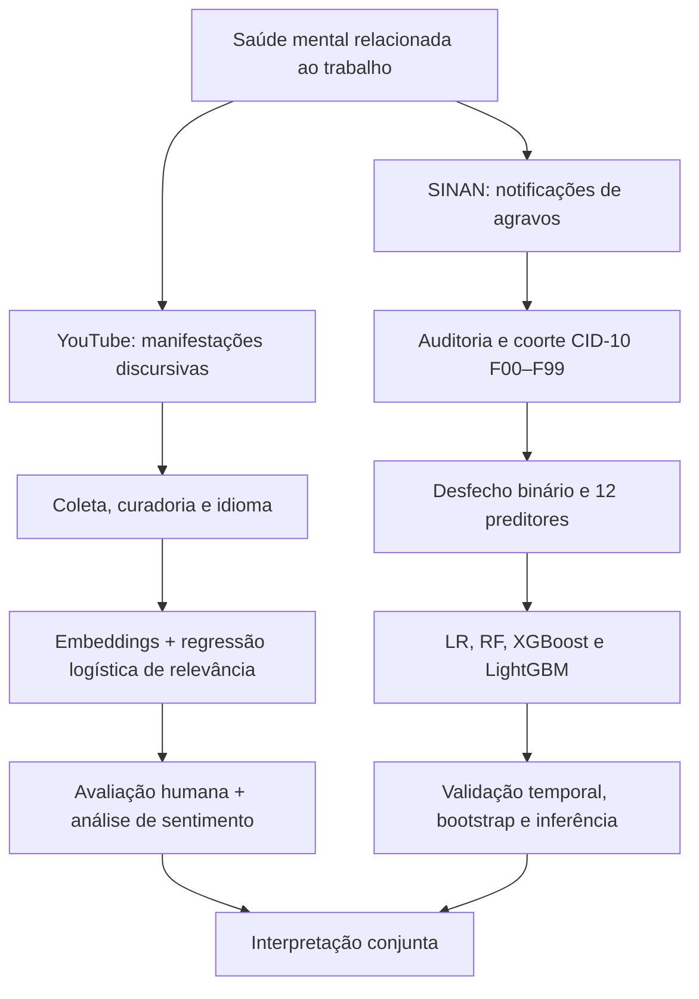

# Saúde mental do trabalhador e riscos psicossociais: narrativas digitais, SINAN e aprendizado de máquina

**Repositório de pesquisa | MBA em Data Science & Analytics — USP/ESALQ | 2026**  
**Autora:** Kymie Karina Silva Saito  
**Situação:** documentação em revisão para correspondência com o TCC; repositório privado.

> **Escopo.** Este repositório documenta dois eixos analíticos independentes: (1) narrativas públicas sobre saúde mental e riscos psicossociais no YouTube; e (2) registros de transtornos mentais relacionados ao trabalho no SINAN. A integração é **interpretativa**, sem vinculação individual, *merge* ou inferência de representatividade comum. O README prioriza os resultados descritos na versão do TCC fornecida em 15/10/2026. Quando a execução integral do código ou a correspondência de arquivos ainda não foi auditada, isso é indicado explicitamente.

## Navegação

1. [Pergunta científica e desenho](#1-pergunta-científica-e-desenho)
2. [Inventário do repositório](#2-inventário-do-repositório)
3. [Pipeline de narrativas digitais](#3-pipeline-de-narrativas-digitais)
4. [Pipeline SINAN](#4-pipeline-sinan)
5. [Formulação matemática dos modelos](#5-formulação-matemática-dos-modelos)
6. [Validação e resultados](#6-validação-e-resultados)
7. [Inferência estatística](#7-inferência-estatística)
8. [Figuras e rastreabilidade](#8-figuras-e-rastreabilidade)
9. [Reprodutibilidade, privacidade e limitações](#9-reprodutibilidade-privacidade-e-limitações)
10. [Divergências em verificação](#10-divergências-em-verificação)
11. [Referências essenciais](#11-referências-essenciais)

## 1. Pergunta científica e desenho

Como narrativas digitais públicas e registros nacionais de transtornos mentais relacionados ao trabalho podem ser analisados de forma complementar por métodos computacionais, sem equiparar suas populações e seus mecanismos de observação?



**Importante:** narrativas negativas não equivalem a diagnóstico clínico. Frequências de comentários não estimam prevalência de sofrimento mental na população trabalhadora. Associações do SINAN não estabelecem causalidade.

## 2. Inventário do repositório

O inventário da branch `main`, consultado em 15/10/2026, identificou o notebook [`sinan_NR1_2014_2026_ATUAL.ipynb`](sinan_NR1_2014_2026_ATUAL.ipynb), arquivos CSV de auditoria e resultados, diversas imagens e a subpasta [`mcp-appwrite-sinan/`](mcp-appwrite-sinan/README.md).

| Recurso | Finalidade documentada | Situação da conferência |
|---|---|---|
| [`sinan_NR1_2014_2026_ATUAL.ipynb`](sinan_NR1_2014_2026_ATUAL.ipynb) | Notebook principal do eixo epidemiológico | Existe; execução integral e mapeamento célula→resultado pendentes |
| [`analise_duplicatas.csv`](analise_duplicatas.csv) | Auditoria de duplicidades | Existe; conferir geração e conteúdo |
| [`analise_missing.csv`](analise_missing.csv) | Auditoria de dados ausentes | Existe; conferir geração e conteúdo |
| [`bloco41_tabela_modelo_inferencial_TCC.csv`](bloco41_tabela_modelo_inferencial_TCC.csv) | Resultados tabulares da inferência | Existe; conferir coeficientes e ICs com o texto |
| [`bloco42_sintese_final_resultados.csv`](bloco42_sintese_final_resultados.csv) | Síntese tabular | Existe; conferir correspondência com tabelas finais |
| [`mcp-appwrite-sinan/`](mcp-appwrite-sinan/README.md) | Protótipo de integração com MCP/Appwrite | Projeto técnico separado; não deve ser apresentado como parte necessária do experimento do TCC |

**Não afirmar reprodução automática completa:** o inventário não confirmou arquivo `requirements.txt` na raiz, dados brutos necessários nem scripts separados para cada etapa do YouTube. O notebook não foi executado nesta revisão.

## 3. Pipeline de narrativas digitais

### 3.1 Recuperação e preparação

Conforme a metodologia do TCC fornecido:

- **Período de publicação pesquisado:** 01/01/2024 a 01/06/2026; na API, `publishedAfter=2024-01-01` e `publishedBefore=2026-07-01` (verificar a coerência entre a data-limite textual e o parâmetro de execução).
- **Fonte:** YouTube Data API v3; `search.list` com `type=video`, `order=date`, `relevanceLanguage=pt` e até cinco resultados por consulta.
- **Organização:** cinco eixos temáticos: NR-1/GRO/PGR; saúde mental e trabalho; riscos psicossociais; cultura e gestão; transformações do trabalho.
- **Coleta declarada no TCC:** comentários de nível superior (*top-level comments*), e não respostas.
- **Armazenamento metodológico:** DuckDB, tabelas `videos_nr1_recoleta` e `comments_nr1_recoleta`, identificadores `video_id` e `comment_id`, deduplicação e inserções incrementais `INSERT OR IGNORE`.
- **Tratamento:** normalização textual, identificação de idioma com `langdetect`, exclusão de textos com menos de oito caracteres e triagem lexical exploratória. O indicador lexical de sofrimento não é diagnóstico.

O texto metodológico do TCC lista **dez descritores por eixo (50 descritores listados)**; isso não prova que 50 chamadas distintas tenham sido concluídas. O README anterior mencionava 23 consultas: a quantidade efetivamente executada deve ser confirmada no log/código de coleta.

### 3.2 Fluxo amostral relatado no TCC

| Etapa | Registros |
|---|---:|
| Vídeos identificados inicialmente | 823 |
| Vídeos selecionados | 150 |
| Comentários brutos extraídos | 7.613 |
| Comentários em português | 5.879 |
| Comentários selecionados por relevância | **2.035** |

A fração selecionada foi $2035/5879\approx 34,61\%$. Esses denominadores são distintos e não devem ser intercambiados.


### 3.3 Representação semântica e classificação de relevância

A metodologia do TCC descreve representações semânticas (*embeddings*) obtidas com o modelo `paraphrase-multilingual-mpnet-base-v2`, da biblioteca Sentence Transformers. Essas representações foram utilizadas como variáveis preditoras em um modelo de **Regressão Logística binária**, treinado com comentários rotulados manualmente para classificação da relevância temática.

Para cada comentário, o modelo de linguagem produz um vetor de representação semântica:

```math
\mathbf{z}_i = f_{\mathrm{encoder}}(x_i) \in \mathbb{R}^{d}
```

em que `x_i` representa o comentário, `z_i` corresponde ao vetor de características semânticas e `d` indica a dimensionalidade da representação.

A similaridade do cosseno entre dois vetores não nulos pode ser expressa por:

```math
\mathrm{sim}(\mathbf{u},\mathbf{v}) =
\frac{\mathbf{u}^{T}\mathbf{v}}
{\lVert\mathbf{u}\rVert_2 \lVert\mathbf{v}\rVert_2}
```

A probabilidade estimada de relevância temática pela Regressão Logística é definida por:

```math
\hat{p}_i =
P(R_i=1\mid\mathbf{z}_i) =
\sigma\left(\beta_0+\boldsymbol{\beta}^{T}\mathbf{z}_i\right)
```

A função sigmoide é dada por:

```math
\sigma(a)=\frac{1}{1+e^{-a}}
```

O TCC relata a avaliação de diferentes limiares de classificação em **280 comentários independentes**, com adoção do ponto de corte de **0,60**. O desempenho foi examinado por meio das métricas de precisão, sensibilidade (*recall*), F1-score, acurácia e acurácia balanceada.

A composição exata dos conjuntos de treinamento, validação e rotulação deve ser verificada nos respectivos artefatos de execução, assegurando a rastreabilidade metodológica.

### 3.4 Sentimento

Após a seleção por relevância, o TCC descreve o classificador pré-treinado `lxyuan/distilbert-base-multilingual-cased-sentiments-student`, com tokenização e truncamento em **512 tokens**. Não há evidência no TCC de *fine-tuning* do Transformer com o corpus.

Para as classes negativa, neutra e positiva, a regra de predição é:

$$\hat s_i=\arg\max_{k\in\{\mathrm{neg},\mathrm{neu},\mathrm{pos}\}}P(S_i=k\mid x_i).$$

O TCC descreve uma avaliação humana cega e estratificada de **180 comentários**, 60 por classe prevista, com opção de rótulo *duvidoso*. São relatadas matriz de confusão, métricas de classificação e $\kappa$ de Cohen, com ressalva de ausência de múltiplos avaliadores independentes. Não se trata de padrão-ouro externo.

**Não confundir** o classificador supervisionado de **relevância** (regressão logística sobre embeddings) com o classificador pré-treinado de **sentimento** (DistilBERT).

## 4. Pipeline SINAN

### 4.1 População e auditoria

| Etapa | N |
|---|---:|
| Registros iniciais | 24.356 |
| Após remoção de cinco duplicidades exatas | 24.351 |
| Coorte CID-10 F00–F99 | 18.292 |
| Evolução classificável para modelagem | **13.598** |
| Casos completos na inferência | **13.533** |

A série analisada no TCC cobre anos disponíveis de 2014–2019 e 2022–2025. **2020 e 2021 são lacunas de disponibilidade**, não contagens zero.

### 4.2 Desfecho e preditores

O desfecho foi construído a partir do campo `EVOLUCAO`:

- $Y=1$: incapacidade temporária, incapacidade permanente parcial ou total, ou óbito relacionado ao trabalho;
- $Y=0$: cura ou cura não confirmada.

Na amostra preditiva: $N_1=11.027$, $N_0=2.571$, totalizando $13.598$ registros; proporção positiva $\hat\pi=11027/13598\approx 0,8109$.

As **12 variáveis preditoras** descritas são idade, sexo, raça/cor, escolaridade, UF, situação de trabalho, terceirização, grande grupo CBO, grupo CID-10, consumo de álcool, uso de drogas e tabagismo. O TCC descreve prevenção de vazamento de dados e ajuste das transformações exclusivamente no treino.


## 5. Formulação matemática dos modelos

Foram considerados quatro algoritmos supervisionados para a classificação binária dos desfechos registrados no SINAN: Regressão Logística (LR), Random Forest (RF), XGBoost e LightGBM.

As expressões a seguir apresentam os fundamentos matemáticos desses métodos. As configurações específicas de treinamento e os hiperparâmetros efetivamente utilizados devem ser consultados no notebook da pesquisa.

### 5.1 Regressão Logística (LR)

A Regressão Logística estima a probabilidade de ocorrência do desfecho binário por meio da transformação logit:

```math
\mathrm{logit}(p_i) =
\ln\left(\frac{p_i}{1-p_i}\right)
= \beta_0 + \sum_{j=1}^{p}\beta_j x_{ij}
```

O preditor linear é definido por:

```math
\eta_i = \beta_0 + \sum_{j=1}^{p}\beta_j x_{ij}
```

A probabilidade estimada é obtida pela função logística:

```math
\hat{p}_i = \frac{1}{1+\exp(-\eta_i)}
```

Uma função de perda utilizada no treinamento da classificação logística binária é a entropia cruzada:

```math
L_{\mathrm{log}} =
-\frac{1}{n}\sum_{i=1}^{n}
\left[
y_i\ln(\hat{p}_i)
+
(1-y_i)\ln(1-\hat{p}_i)
\right]
```

Nessas expressões, `y_i` representa o desfecho observado, `p_i` a probabilidade modelada, `x_ij` o valor da variável preditora `j` para a observação `i`, e `beta_j` os coeficientes do modelo.

### 5.2 Random Forest (RF)

O Random Forest combina múltiplas árvores de decisão construídas com aleatoriedade na seleção de observações e variáveis.

Na classificação, uma das medidas de impureza utilizadas para avaliar divisões é o índice de Gini:

```math
G(S) = 1-\sum_{k=1}^{K}p_k^2
```

Em que `p_k` representa a proporção de observações da classe `k` no nó `S`.

A probabilidade estimada pela floresta pode ser representada pela média das probabilidades fornecidas pelas árvores:

```math
\hat{p}_{RF}(x) =
\frac{1}{B}\sum_{b=1}^{B}\hat{p}_b(x)
```

Em que `B` representa o número de árvores e `p_b` a probabilidade estimada pela árvore `b`.

### 5.3 XGBoost

O XGBoost é um algoritmo de *gradient boosting* que constrói um modelo aditivo de árvores, no qual cada nova árvore contribui para corrigir os erros da composição anterior.

Uma representação do modelo aditivo é:

```math
F_M(x) = F_0(x) + \sum_{m=1}^{M}\eta f_m(x)
```

Em que `F_0` representa a predição inicial, `f_m` a contribuição da árvore `m`, `M` o número de etapas de boosting e `eta` a taxa de aprendizado.

Uma forma da penalização de complexidade das árvores é:

```math
\Omega(f) =
\gamma T + \frac{\lambda}{2}\sum_{j=1}^{T}w_j^2
```

Em que `T` é o número de folhas, `w_j` é o peso associado à folha `j`, `gamma` penaliza a complexidade estrutural e `lambda` controla a regularização quadrática.

O XGBoost utiliza uma aproximação de segunda ordem da função de perda, considerando gradientes e derivadas segundas em relação aos escores brutos:

```math
g_i =
\frac{\partial \ell(y_i,F_i)}{\partial F_i}
```

```math
h_i =
\frac{\partial^2 \ell(y_i,F_i)}{\partial F_i^2}
```

Essas expressões caracterizam o algoritmo. Os valores efetivamente utilizados para regularização, profundidade das árvores, taxa de aprendizado e número de estimadores devem ser verificados no código executado.

### 5.4 LightGBM

O LightGBM também pertence à família dos algoritmos de *gradient boosting* baseados em árvores de decisão.

Sua implementação utiliza estratégias computacionais voltadas à eficiência, incluindo construção de histogramas e crescimento das árvores orientado por folhas (*leaf-wise*).

Assim como no XGBoost, a predição é construída de forma aditiva:

```math
F_M(x) = F_0(x) + \sum_{m=1}^{M}\eta f_m(x)
```

A presença do LightGBM na comparação empírica não implica que todos os recursos opcionais da biblioteca tenham sido ativados.

A avaliação comparativa dos quatro modelos foi conduzida por validação temporal, com resultados apresentados na Seção 6.

## 6. Validação e resultados

### 6.1 Validação temporal expansiva

| Treino | Validação |
|---|---|
| 2014–2016 | 2017 |
| 2014–2017 | 2018 |
| 2014–2018 | 2019 |
| 2014–2019 | 2022 |
| 2014–2022 | 2023 |

Desenvolvimento: **9.130** registros (2014–2023). Predições temporais *out-of-fold* (OOF): **6.791**. Avaliação temporal posterior: **2024, n=2.710**; 2025 é avaliação complementar.

### 6.2 Métricas

$$\mathrm{Sensibilidade}=\frac{TP}{TP+FN},\qquad \mathrm{Especificidade}=\frac{TN}{TN+FP}.$$

$$\mathrm{Precisão}=\frac{TP}{TP+FP},\qquad F_1=2\frac{\mathrm{Precisão}\,\mathrm{Sensibilidade}} {\mathrm{Precisão}+\mathrm{Sensibilidade}}.$$

$$\mathrm{Acurácia\ balanceada} = \frac{\mathrm{Sensibilidade}+\mathrm{Especificidade}}{2}. $$

ROC-AUC e PR-AUC foram consideradas conjuntamente. A interpretação da PR-AUC depende também da prevalência da classe positiva.

### 6.3 Comparação OOF

| Modelo | ROC-AUC | PR-AUC |
|---|---:|---:|
| Regressão Logística | **0,707** | **0,913** |
| XGBoost | 0,700 | 0,912 |
| Random Forest | 0,688 | 0,907 |
| LightGBM | 0,680 | 0,906 |

A tabela usa os valores do TCC anexado; o README anterior informava PR-AUC de 0,913 para XGBoost, diferença que exige verificação na tabela gerada pelo notebook.

### 6.4 Bootstrap pareado

As diferenças de métricas entre LR e XGBoost foram calculadas nas **mesmas 6.791 observações OOF**, com reamostragem pareada e estratificação por ano.

$$ \Delta_{\mathrm{ROC}}=\mathrm{ROC\!-\!AUC}_{LR} -\mathrm{ROC\!-\!AUC}_{XGB},\qquad \Delta_{\mathrm{PR}}=\mathrm{PR\!-\!AUC}_{LR}-\mathrm{PR\!-\!AUC}_{XGB}.$$

Resultados descritos no README anterior e no histórico analítico da pesquisa (conferir no notebook): $\Delta_{\mathrm{ROC}}=0,0073$, IC95% $[-0,0036;\ 0,0183]$; $\Delta_{\mathrm{PR}}=0,0004$, IC95% $[-0,0043;\ 0,0049]$. Como os ICs incluem zero, **não foi demonstrada superioridade estatística da LR sobre XGBoost** nessas comparações.

### 6.5 Avaliação temporal de 2024

| Modelo | ROC-AUC | PR-AUC |
|---|---:|---:|
| LR | 0,778 | 0,882 |
| RF | 0,763 | 0,878 |
| XGBoost | **0,786** | **0,896** |
| LightGBM | 0,777 | 0,887 |

O XGBoost teve maior discriminação em 2024; a escolha da LR como modelo principal considerou o desenvolvimento temporal, a parcimônia e a interpretabilidade, e não uma alegação de vitória em todos os períodos.

### 6.6 Limiar de decisão

Para um limiar $t$:

$$\hat Y_i(t)=\mathbf 1[\hat p_i\ge t],\qquad J(t)=\mathrm{Sens}(t)+\mathrm{Esp}(t)-1.$$

O README anterior documenta seleção aproximada de **$t^*=0,88$** nas predições OOF pelo índice de Youden e aplicação fixa nos períodos posteriores. **Esse limiar não é um corte clínico** e sua execução precisa ser reconciliada com as tabelas finais do TCC.


## 7. Inferência estatística

A análise inferencial foi conduzida separadamente da comparação preditiva dos algoritmos. Foram utilizados **13.533 casos completos**, dos quais **10.976** pertenciam à classe positiva e **2.557** à classe negativa.

Foi ajustado um modelo de Regressão Logística multivariável, com estimação de erros-padrão robustos do tipo **HC3**.

### 7.1 Especificação do modelo

A relação entre as variáveis explicativas e a probabilidade do desfecho foi representada pela função logit:

```math
\mathrm{logit}(p_i) =
\beta_0 + \sum_{j=1}^{p}\beta_j X_{ij}
```

A probabilidade correspondente é:

```math
p_i =
\frac{1}{1+\exp\left(-\beta_0-\sum_{j=1}^{p}\beta_j X_{ij}\right)}
```

Em que `p_i` representa a probabilidade do desfecho para a observação `i`, `X_ij` representa a variável explicativa `j` e `beta_j` corresponde ao respectivo coeficiente.

### 7.2 Razões de chances e intervalos de confiança

Os coeficientes da Regressão Logística foram transformados em razões de chances ajustadas (*adjusted odds ratios*, ORa):

```math
OR_j = \exp(\beta_j)
```

O intervalo de confiança aproximado de 95% foi obtido pela transformação exponencial dos limites calculados na escala logit, utilizando o erro-padrão robusto HC3:

```math
IC_{95\%}(OR_j) =
\left[
\exp\left(\hat{\beta}_j - 1.96\,SE_{HC3}(\hat{\beta}_j)\right),
\exp\left(\hat{\beta}_j + 1.96\,SE_{HC3}(\hat{\beta}_j)\right)
\right]
```

Nessa expressão, `SE_HC3` representa o erro-padrão robusto do coeficiente estimado.

### 7.3 Especificação da idade

Foram examinadas formas funcionais linear, quadrática e flexível (*splines*) para a variável idade.

A especificação quadrática foi selecionada considerando critérios de ajuste e parcimônia.

O máximo ajustado da relação modelada foi relatado em aproximadamente **47,6 anos**. Esse resultado descreve o comportamento estimado da associação no modelo e não deve ser interpretado como ponto de corte clínico.

### 7.4 Associações estimadas

Entre os resultados apresentados na análise multivariável, destacam-se as seguintes razões de chances ajustadas:

| Variável | OR ajustada |
|---|---:|
| Sexo masculino | 1,216 |
| Raça/cor parda | 1,324 |
| Raça/cor preta | 1,493 |
| Grupo CID F3 versus F4 | 2,257 |
| Uso de drogas registrado como "Sim" | 3,699 |

As categorias de referência, os intervalos de confiança e os valores de significância devem ser consultados na tabela de resultados inferenciais:

[bloco41_tabela_modelo_inferencial_TCC.csv](https://github.com/KymieSaito/tcc-sinan-riscos-psicossociais/blob/main/bloco41_tabela_modelo_inferencial_TCC.csv)

### 7.5 Interpretação e limitações

As razões de chances ajustadas representam associações condicionais às demais variáveis incluídas no modelo.

Uma OR superior a 1 indica maiores chances do desfecho em relação à categoria de referência, enquanto uma OR inferior a 1 indica menores chances, mantidas as demais condições do modelo.

**A razão de chances não equivale ao risco relativo nem à probabilidade de ocorrência do desfecho.**

Por se tratar de análise observacional baseada em registros secundários, as associações estimadas não devem ser interpretadas como evidências de causalidade.

**OR não é risco relativo nem probabilidade; associações observacionais não estabelecem efeitos causais.**

## 8. Figuras e rastreabilidade

O TCC numera figuras por **conteúdo científico**, não pelo nome arbitrário de um PNG. A tabela abaixo é um **mapa de candidatos**, não uma correspondência visual certificada.

| Elemento do TCC | Arquivo candidato existente | Verificação necessária |
|---|---|---|
| Figura 1 — arquitetura do estudo | [`figura1.png`](figura1.png) | Comparar com a imagem inserida no DOCX |
| Figura 4 — caracterização epidemiológica | [`dashboard_1_caracterizacao_epidemiologica.png`](dashboard_1_caracterizacao_epidemiologica.png) | Confirmar painéis, período e denominadores |
| Figura 5 — comparação preditiva e estabilidade | [`estabilidade_temporal_quatro_modelos.png`](estabilidade_temporal_quatro_modelos.png), [`capacidade_comparativa_quatromodelos.png`](capacidade_comparativa_quatromodelos.png) | Confirmar qual imagem corresponde a cada painel A–D |
| Figura 6 — síntese dos resultados | [`dashboard_final_resultados_TCC.png`](dashboard_final_resultados_TCC.png) | Confirmar identidade visual e números |
| Figura suplementar — idade | [`bloco39_curva_ajustada_idade.png`](bloco39_curva_ajustada_idade.png) | Conferir modelo e dados geradores |
| Figura suplementar — OR | [`bloco40_forest_plot_modelo_final.png`](bloco40_forest_plot_modelo_final.png) | Conferir ICs, categorias de referência e amostra |

**Figuras 2 e 3 do eixo YouTube:** não foi identificada, por nome, uma correspondência inequívoca no inventário do repositório. Não apontar imagens de outro experimento como se fossem essas figuras.

**Higienização sem exclusão:** `curvadecalibracao.png` e `curvadecalibracao2024.png` têm o mesmo SHA Git no inventário consultado; versões `dashboard_epidemiologico_executivo*`, `output*.png` e `estabilidade_temporal_quatro_modelos3.png` devem ser auditadas antes de qualquer remoção. Manter os arquivos atuais até confirmação.

## 9. Reprodutibilidade, privacidade e limitações

1. **Estado atual:** repositório **privado**. Seu acesso depende das permissões concedidas pela proprietária; não se deve descrevê-lo como público no TCC enquanto essa configuração permanecer.
2. **Dados:** microdados brutos, identificadores pessoais, credenciais, tokens e segredos não devem ser publicados. A ausência desses arquivos limita a reprodução integral por terceiros.
3. **Ambiente:** registrar versões de Python e bibliotecas, sementes aleatórias, parâmetros e fontes originais. Não presumir que um `requirements.txt` já exista.
4. **Rastreabilidade:** cada número final deve apontar para uma célula/função do notebook, tabela exportada, amostra e data de execução. Este vínculo ainda está em auditoria.
5. **YouTube:** comentários são autoselecionados e não constituem amostra representativa; modelos de sentimento podem errar em ironia, ambiguidade e linguagem contextual.
6. **SINAN:** dados de notificação estão sujeitos a subnotificação, ausência de campos e mudanças temporais; o desfecho binário é uma operacionalização de categorias administrativas.
7. **Segurança:** manter cópias locais e externas do repositório; um repositório privado não substitui um backup.

## 10. Divergências em verificação

Esta seção é deliberadamente explícita: não substituir evidências conflitantes por um número “corrigido” sem auditoria.

| Tema | TCC anexado | README anterior | Encaminhamento |
|---|---|---|---|
| Corpus YouTube | 2.035 comentários relevantes; 150 vídeos selecionados | 1.031 narrativas; 196 vídeos | Tratar como versões/recortes diferentes até identificar código e data de cada extração |
| Unidade textual | Comentários de nível superior | Comentários + respostas | Confirmar código de coleta e manter o método do TCC como referência desta versão |
| Busca | 5 eixos; 10 descritores listados por eixo | 23 consultas | Conferir consultas efetivamente executadas |
| Auditoria de relevância | 280 comentários independentes para limiar; classificação supervisionada | 200 narrativas auditadas e reconstrução | Não equiparar amostras; documentar cronologia experimental |
| Avaliação de sentimento | 180 comentários em avaliação cega estratificada | 200 comparações assistidas | Distinguir validação final de análise exploratória |
| PR-AUC XGBoost OOF | 0,912 | 0,913 | Conferir precisão numérica e arquivo de resultados |
| Data-limite de publicação YouTube | Texto: 01/06/2026; parâmetro API: `publishedBefore=2026-07-01` | Recorte de 2026 | Confirmar critério efetivo de inclusão e data do processamento |
| Disponibilidade do código | TCC menciona repositório como público em um trecho | GitHub atualmente privado | Ajustar texto do TCC ou alterar acesso somente após decisão explícita |

## 11. Referências essenciais

Referências metodológicas citadas no TCC e/ou no README original; a formatação bibliográfica completa deve seguir a lista de referências da versão final do trabalho:

- Breiman, L. (2001). *Random Forests*. Machine Learning.
- Chen, T.; Guestrin, C. (2016). *XGBoost: A Scalable Tree Boosting System*. KDD.
- Christodoulou, E. et al. (2019). *A systematic review shows no performance benefit of machine learning over logistic regression for clinical prediction models*. Journal of Clinical Epidemiology.
- Ke, G. et al. (2017). *LightGBM: A Highly Efficient Gradient Boosting Decision Tree*. NeurIPS.
- Reimers, N.; Gurevych, I. (2019). *Sentence-BERT: Sentence Embeddings using Siamese BERT-Networks*. EMNLP-IJCNLP.
- Steyerberg, E. W.; Harrell, F. E. (2016). *Prediction models need appropriate internal, internal–external, and external validation*. Journal of Clinical Epidemiology.
- Documentação dos modelos: `sentence-transformers/paraphrase-multilingual-mpnet-base-v2` e `lxyuan/distilbert-base-multilingual-cased-sentiments-student`.

---

**Estado desta versão:** README revisado a partir do TCC fornecido, do README anexado e do inventário GitHub. Nenhum arquivo do repositório foi modificado. A revisão **não substitui** uma execução reprodutível do notebook nem a conferência visual das figuras.
